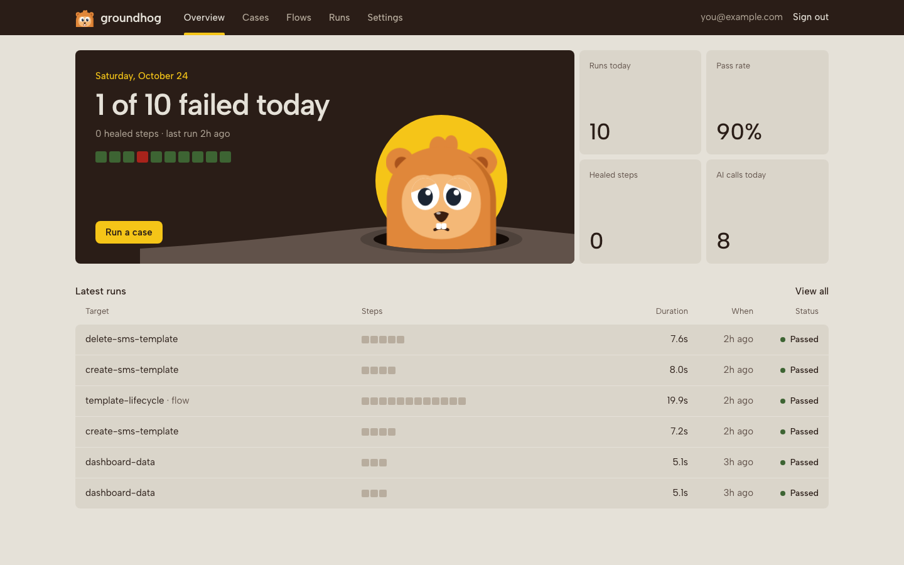
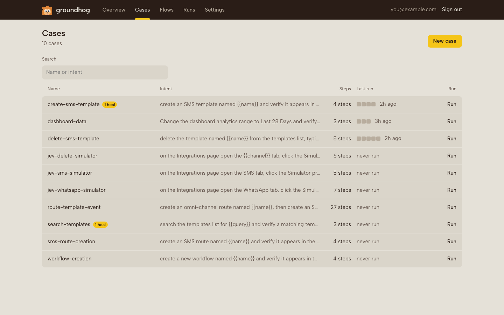
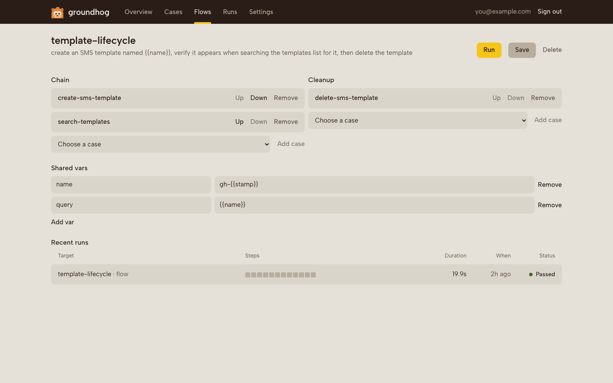
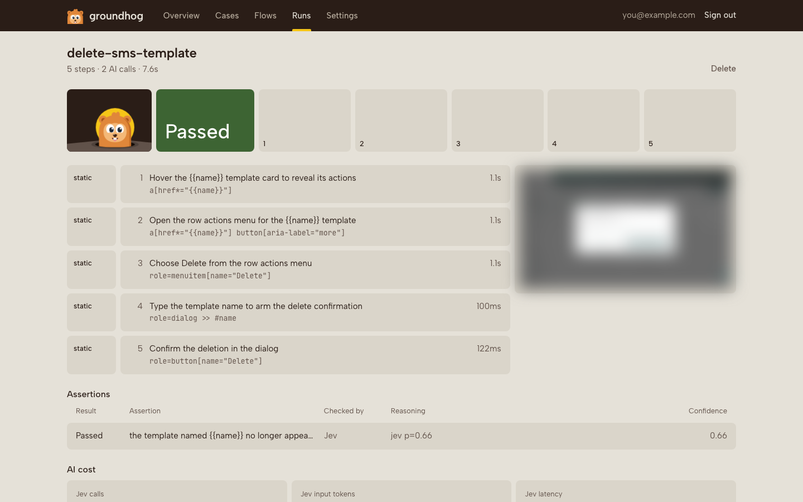
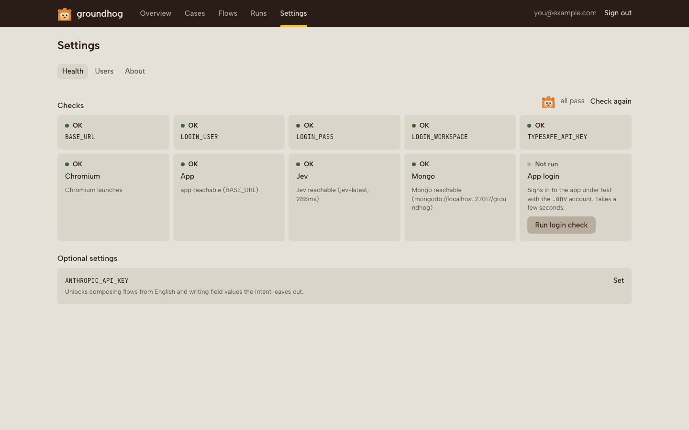
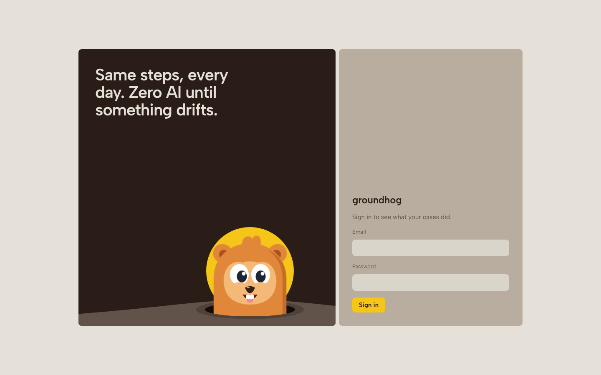

<p align="center">
  
</p>

<h1 align="center">groundhog</h1>

<p align="center"><b>Describe a test in English once. Replay it forever, for free.</b></p>

Groundhog is end-to-end testing for SaaS apps. You write what a user does in a sentence, and groundhog turns it into a test that runs on every deploy without calling an AI model.

## The problem

AI agents can click through a browser now. You've seen the demos.

But they forget everything between runs. The thousandth run of the same test looks exactly like the first: the agent reads the page, hunts for the same button, and pays for the same tokens. Your test bill grows with every deploy, and the test is only as steady as the model's mood that day.

Groundhog pays that cost once.

## How it works

**1. Describe it.** Type the test the way you'd explain it to a new teammate:

> Create an SMS template named {{name}} and verify it appears in the templates list.

**2. Groundhog drives your app, once.** It opens your real app, does the task, and saves every step it took as plain, readable selectors. The `{{name}}` becomes a variable, so the same test can run with fresh data every time.

**3. Every run after that is free.** Replays read the saved steps and check each one. That takes a few seconds per test and 0 model calls.

**4. When your UI changes, it heals.** If a button moves or gets renamed, 1 small AI call finds the element the step meant, checks that it worked, and updates the saved test. A heal is only kept when the whole run passes, so a bad guess never sticks.

Like the movie. It wakes up, lives the same day again, and gets a little better at it each time.

## What you can do

**Write tests in English.** One sentence per test. Groundhog does the clicking, picks durable selectors (test ids first, then labels and roles), and adds a check after each step so a click that did nothing counts as a failure.

**Run them with different data.** Every `{{variable}}` is filled at run time. Leave it empty and groundhog stamps a fresh value like `gh-120501-a3f9`, so 2 runs never trip over each other's leftovers.

**Chain tests into flows.** A flow strings saved tests into a longer story: create a template, use it in a campaign, delete both. One browser, one login, shared variables. Describe the whole flow in English and groundhog reuses the tests you already have and writes the missing ones in the same pass.

**Clean up after yourself.** Cleanup steps in a flow run even when the flow fails, and a flow only passes when its cleanup passes too.

**Check things in plain English.** "The template appears in the list" works as an assertion. Groundhog judges it against the final page and shows how confident it is. Exact checks like "the URL contains /templates" skip the AI completely.

**Wait less while it writes.** An assertion with 3 clauses is judged in 1 request, all clauses at once. While groundhog authors a test, the "is it done yet" check rides along with each decision about the next click, so knowing when to stop costs 0 extra round trips. It only looks a second time when the page actually changed.

**See where your AI money goes.** Every run reports how many AI calls it made and why. A passing test with no English assertions makes 0, and the run page says so.

**Run the whole suite.** Run all your tests, or just the ones you picked. The console runs 3 at a time (set `MAX_WORKERS` to change that) and the rest wait in the queue. From the terminal, several tests share one browser and one login, and the exit code is 1 if any of them failed.

**Retry once, and know it happened.** A failed test can run again with fresh data. If the retry passes, the run counts as passed and gets a yellow flaky tag, so a shaky test doesn't hide.

**Know which tests to trust.** Every test shows its last 10 runs: how many passed, how long they took on average, how often it healed and how often it was flaky.

**Find what you haven't tested.** A crawl follows the links in your app and records every page it reaches, with 0 AI calls. It never clicks a button. Then groundhog matches those pages against your tests and lists the gaps: pages no test visits, and buttons that create, change or delete data that no test presses.

**Get test ideas.** Point groundhog at your product docs, paste release notes, or hand it the gaps. Claude reads them along with the tests you already have and suggests new ones, each a sentence you can author in 1 click.

## The console

Everything lives in a web console your whole team can sign into.



**Overview.** Opens with the day's verdict in big type: "All 10 runs passed" or "1 of 10 failed today". A strip of today's runs sits under it, one square per run in green or red, and the latest runs are listed below.

**Cases.** Every test with its last 10 runs as a strip, how many passed ("9/10"), its average time and a yellow tag when it has healed or been flaky. Search by name or intent, run one test in 1 click, tick a few and run them together, or Run all (it tells you roughly how long that takes first). Write a new test from a sentence, or ask for suggestions. Each test's page has a health board on top: pass rate, average time, heals and flaky runs.



**Coverage.** Two tabs.

The Map tab shows every crawled page, grouped by section ("templates · 3 of 7 covered"). Each page is a tile with its path, how many controls it has and the tests that visit it. A page no test reaches sits on a darker tile. Below the map, a Gaps list names the buttons that create, change or delete data and that no test presses. Hit Crawl to map the app again (pick a scope like `/templates` and a page limit).

The Suggestions tab turns docs URLs, pasted text and the map's gaps into test ideas. Each one shows its sentence, why it's worth having and where it came from. Author one, tick several and author them all, or dismiss the ones you don't want. It needs an Anthropic key.

**Flows.** Build a chain from your saved tests, set shared variables and cleanup, or describe a new flow in English.



**Run.** Watch a test as it happens. Each step lands as a tile coloured by how it ran (replayed, used a fallback, healed or failed), with a screenshot of the page after each step. Click a tile to jump to that step. When the run ends you see every assertion, its reasoning and what it cost. If the test retried, the failed attempt folds into one collapsed row and the tiles show the attempt that counted.



**Runs.** The full history, filtered by kind (crawls included), status or test name. Queued runs wait here until a slot frees up, and the top bar counts what's live and what's queued.

**Settings.** A health check for everything groundhog needs (the app, the login, the database, the AI service), how many runs go at once, plus users and roles.



### Meet the groundhog

The console has a mascot, and it tells you how things are going.

It pops out of its burrow in front of a sunrise. When every run passed, it squints happily. When something failed, it sinks lower and looks worried. While a run is live, it rocks back and forth digging. With nothing run yet, it's asleep in its hole. And while you type your password on the login screen, it squeezes its eyes shut.

You'll find it on the Overview, on every run, on empty pages, in the top bar while a run is live, and on the health screen.



## Safe with your credentials

Groundhog signs in through your app's own login API, so SSO-only login pages are fine. Your username and password stay in your own config. They never go to a model and never appear in a saved test, a screenshot or a page snapshot. Password fields are stripped before anything leaves the browser.

The console needs a signed-in session for everything except the login page. Passwords are hashed, and there are 2 roles: admins manage users and delete things, members do the rest.

## Try it

You need Node 20+, [uv](https://docs.astral.sh/uv/), MongoDB (or Docker), a TypeSafe API key from [console.typesafe.ai](https://console.typesafe.ai) and an app to test.

```sh
git clone <this repo> && cd groundhog
./start.sh
```

The script checks everything, tells you what's missing, and opens the console at http://localhost:8000. Fill in `.env` with your app's URL and a test login, run it again, and write your first test.

## Run it in CI

Every saved test, one browser, each failure retried once:

```sh
uv run groundhog run --all --retries 1
```

Name tests instead of `--all` to run just those. The command exits with 1 if any test failed, so your pipeline goes red.

To map one part of the app:

```sh
uv run groundhog crawl --scope /templates
```
